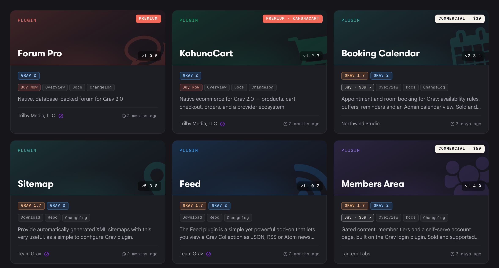
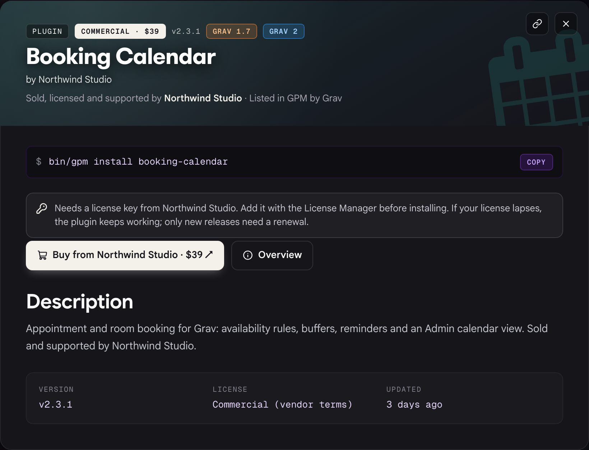

# Commercial Extensions

> [!NOTE]
> **Proposal, open for feedback.** Commercial listings have not launched yet. The prices and rules below are where we plan to start, and we want to hear from developers who would sell through GPM, and from the people who would buy, before anything goes live.

Grav's package directory (GPM, the getgrav.org downloads pages, and the plugin and theme screens in the Admin) has always listed two kinds of package: free open-source extensions from the community, and **Premium** extensions built and sold by the Grav team. **Commercial** listings add a third kind: paid themes and plugins built, sold and supported by independent developers and studios.

A Commercial package installs and updates exactly like any other package (`bin/gpm install`, the Admin, update notifications). The difference is who you buy it from. You buy it from the vendor, on the vendor's own site, under the vendor's terms. Grav lists it, checks your license key when you download it, and holds every vendor to the listing rules below. Grav does not sell it and does not take a cut of the sale.

## Three kinds of package

| | Free | Premium | Commercial |
|---|---|---|---|
| Built by | Anyone | The Grav team (Trilby Media) | An independent vendor |
| Sold by | Nobody, it's free | getgrav.org or kahunacart.com | The vendor's own store |
| Supported by | The author, best effort | The Grav team | The vendor |
| License key needed | No | Yes | Yes |
| Badge | None | **Premium** (coral) | **Commercial · $price** (light) |

Premium and Commercial use different badges on purpose. Premium means the Grav team built it and stands behind it. Commercial means a vendor you are buying from directly built it, and Grav has reviewed and listed it.

## How Commercial packages appear

On the plugin listing, Commercial packages sit alongside free and Premium ones. The light badge shows the price, the buy button says it leads to the vendor's site, and the footer names the vendor:

Themes follow the same pattern:

The package details name who sells, licenses and supports the package, and explain what the license key covers before you buy:

> [!NOTE]
> These screenshots are mockups. The vendors and packages shown (Northwind Studio, Lantern Labs, Pixel & Pine) are fictional.

## Buying and installing a Commercial package

1. Click **Buy** on the listing. You are taken to the vendor's store, where you pay the vendor directly. Tax, receipts and refunds are between you and the vendor.
2. The vendor emails you a license key.
3. Add the key to your site **before** installing, with the License Manager plugin, `bin/plugin license-manager add`, or by hand in `user/data/licenses.yaml`. The download itself is licensed, so a site without the key cannot fetch the package.
4. Install as usual with `bin/gpm install <slug>` or from the Admin.

When getgrav.org receives the download request, it asks the vendor's store whether the key is valid for that package and serves the zip only if it is. Updates work the same way.

**If your license lapses, nothing on your site stops working.** A lapsed key still installs every release published while it was current. Only releases published after it lapsed need a renewal. Commercial packages are not allowed to disable themselves, lock features, or nag in the Admin when a license expires (see [Listing rules](#listing-rules)).

## Selling a Commercial package

### What you need

* **A store that issues license keys.** The simplest route is a Grav site running [KahunaCart](https://kahunacart.com) with the KahunaCart Licenses add-on: it sells your packages, emails keys, handles renewals, and provides the validation API GPM talks to. Any other store works too, as long as it can answer the validation request described in [The validation API](#the-validation-api).
* **A private GitHub repository** for each package, with tagged releases following the normal [GPM release process](../gpm-submission), and a read-only access token so getgrav.org can fetch release zips. Customers never see the repository.
* **A listing that passes review.** Packages go through the same review as free [GPM submissions](../gpm-submission), plus a Grav 2.0 compatibility check (see [Plugin Compatibility](../plugin-compatibility)).
* **Public sales terms**: price, refund policy and a support contact, all linked from the listing.

### The validation API

When a customer downloads your package, getgrav.org sends your store:

[codesh=http]
POST https://your-store.example/api/v1/kahunacart/licenses/public/validate
Content-Type: application/json

{"key": "XXXXX-XXXXX-XXXXX-XXXXX", "product": "your-package-slug"}
[/codesh]

Your store answers with a signed JSON response:

* **200** with `valid: true` and an optional `updates_until` timestamp, when the key covers that product. If `updates_until` is earlier than the release being downloaded, the customer is sent to your renewal page instead.
* **404** for a key your store never issued.
* **409** for a real key that belongs to a different product, with a message saying what the key is for.

KahunaCart Licenses implements this API out of the box. If you use another store, implement the same responses and the same response signature.

### Listing rules

Every Commercial listing agrees to these rules. They protect customers and keep the directory trustworthy:

* **A lapsed license never breaks a running site.** Licenses gate downloads and updates only. No remote kill switches, no locked features, no admin nags or countdowns.
* **No phoning home** beyond what the License Manager and GPM already do. A package must not send site data to the vendor.
* **Same code quality and security bar as any GPM package.** A serious security problem that goes unfixed after being reported is grounds for delisting.
* **Clear terms on the listing**: price, what a license covers (one site, unlimited sites, how long updates last), refund policy and support contact.
* **A working store and validation API.** If your store or API goes dark, the listing is hidden until it is back.
* **Free or freemium editions are welcome.** A free core in GPM with a paid add-on is fine. The free part follows the normal free listing rules and costs nothing to list.

### Pricing

Listing a free package is free and always will be. Commercial listings pay a flat yearly fee based on how many paid packages you list. Grav takes no percentage of your sales.

| Plan | Paid packages | Price per year |
|---|---|---|
| Single | 1 | $49 |
| Studio | Up to 5 | $149 |
| Unlimited | Any number | $299 |

For comparison: at $149 a year, a vendor selling $1,500 of licenses a year pays the equivalent of a 10% cut, and one selling $3,000 a year pays 5%, roughly what a payment processor alone charges. The more you sell, the smaller the fee becomes in percentage terms.

**Founding vendors:** the first five vendors approved get half price, locked in for their first two years.

**KahunaCart discount:** vendors who buy a listing plan get 20% off [KahunaCart](https://kahunacart.com), the Grav-native store that sells your packages and issues your license keys. Buy the listing plan first and the discount code comes with it. On KahunaCart's $249 price that saves about $50, which covers a year of the Single plan.

The fee covers the listing on getgrav.org and in the Admin, license-checked downloads and updates served through getgrav.org, update notifications to every site that has your package installed, and the review.

### If a listing fee lapses

Your listings are hidden from search and new installs, but customers who already bought from you keep getting updates for 60 days. Renew within that time and nothing changes. After that, downloads stop until the listing is renewed, and existing installs keep working as they are.

### Applying

Open a GPM submission as usual, and mention that the package is Commercial. Include the link to your store, your price and refund policy, and the base URL of your validation API. We will review the package, set up the access token and validator with you, and send you the listing fee checkout once it passes.

## FAQ

**Why a flat fee instead of a percentage?** Taking a percentage would put Grav in the middle of every sale: tax, refunds, chargebacks and payouts. A flat fee keeps the sale between you and your customer, and it's cheaper for any vendor with real sales.

**Can I also sell my package elsewhere?** Yes. Listing on GPM is not exclusive.

**Who handles VAT, sales tax and refunds?** You do, or your store does. You are the seller.

**What happens if a vendor disappears?** The listing is hidden once the vendor's validation API stops answering or the fee lapses past the grace period. Installed copies keep working, because licenses never disable a running site.

**What is the difference between Premium and Commercial again?** Premium packages are built and supported by the Grav team. Commercial packages are built and supported by the vendor named on the listing.
