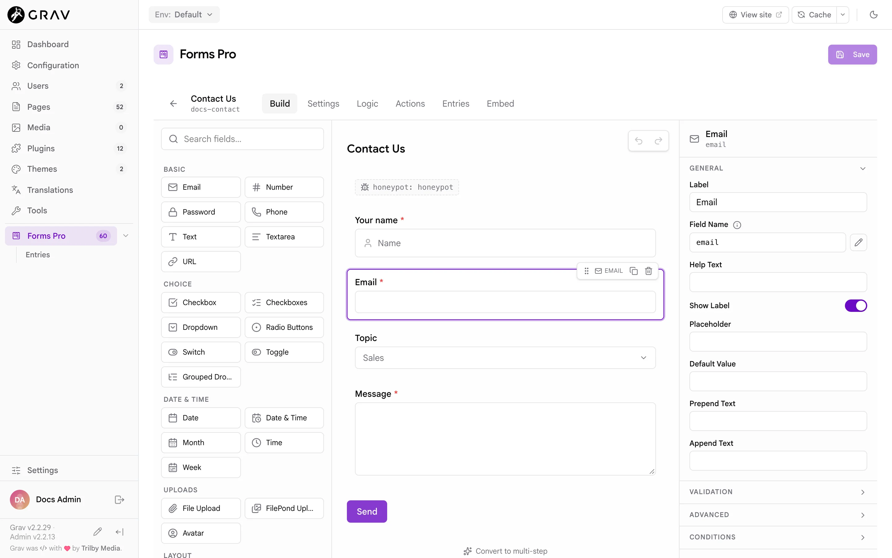

# The Builder

The builder is where you design a form. This page walks through the forms list, the editor's tabs, and the Build tab with its palette, canvas and property panel.

## The forms list

**Forms Pro** in the Admin2 sidebar opens the **Forms** section, a grid of cards. Each card shows the form's title, its name, how many fields it has and when it was last updated. Use the search box to filter by title or name. The sidebar item has an **Entries** item under it, and the page has an **Entries** section next to **Forms**, for accounts that handle entries (see [Entries](../entries)).

The menu on a card offers:

| Action | What it does |
|---|---|
| **View entries** | Opens the form's entries |
| **Duplicate** | Copies the form as `<name>-copy` (then `-copy-2` and so on), titled `<title> (Copy)`. Entries are not copied. |
| **Delete** | Removes the form **and all its entries**, after a confirmation that says how many. Pages that embed the form stop showing it. This cannot be undone. |

Deleting needs both the Manage Forms and the Manage Submissions permissions, because it deletes entries too.

## The editor

Click a card, or create a form with **New Form**, to open the editor. The header shows the form's title and name, a dot while there are unsaved changes, and these tabs:

| Tab | What it is for |
|---|---|
| **Build** | Fields, layout and every field's properties |
| **Settings** | Title, buttons, error display, spam protection and calculator mode ([Settings tab](../settings-tab)) |
| **Logic** | Rules that show or hide fields ([Conditional logic](../conditional-logic)) |
| **Actions** | What happens when the form is sent ([Actions and notifications](../actions-and-notifications)) |
| **Entries** | The submissions of this form |
| **Embed** | Snippets for placing the form on a page ([Embedding](../embedding)) |

An account that may read forms but not change them sees every tab with a **Read only** badge, and nothing can be edited.

## The Build tab

The Build tab has three columns: the palette on the left, the canvas in the middle and the property panel on the right.

### The palette

The palette lists the 49 field types, grouped as Basic, Choice, Date & Time, Uploads, Layout, Pro Fields, Security, Advanced and System. A small sparkle icon marks the Pro fields. The search box filters by name and keywords, so `phone` finds both Phone fields. Hover over an entry for a one-line description. The [Field reference](../field-reference) describes every one.

To add a field, click its entry or drag it onto the canvas.

- A click adds the field at the end of the form, above the buttons. If a container such as Columns or Fieldset is selected and the field may go inside it, it goes there instead. In a multi-step form it goes into the step you are viewing.
- A drag lets you choose the exact spot. A line shows where it will land, and a container highlights when you hover over it.

### The canvas

The canvas draws the form close to how visitors see it. Click a field to select it. A small toolbar appears above the selected or hovered field:

- The **grip** drags the field to a new position, into a container, or out of one.
- **Duplicate** copies the field and gives the copy a unique name.
- **Delete** removes it. Deleting a container asks first when it holds fields, because they go with it. `Delete` or `Backspace` on a selected field does the same.

Text on the canvas edits in place: click a field's label, a fieldset's legend, a tab or step title or a Repeater's title and type. For Radio Buttons, Checkboxes and Dropdown fields, the options show on the canvas while the field is selected, and you click an option to rename it, remove it, or add another.

Under the form is **Convert to multi-step**, which wraps the form in steps (see [Multi-step forms](../multi-step-forms)).

### The property panel

Select a field and the panel on the right shows its properties in collapsible sections. Which sections appear depends on the field:

| Section | Holds |
|---|---|
| **General** | **Label**, **Field Name**, **Help Text**, **Show Label**, and the placeholder or default value |
| **Options** | Choices, ranges, formats and other settings specific to the field |
| **Validation** | **Required**, **Validation Message** and the field's limits, such as minimum and maximum length |
| **Advanced** | **Input Classes**, **Wrapper Classes**, **Label Classes**, **Element ID**, **Field Size**, and for input fields **Disabled**, **Read Only**, **Autofocus** and **Autocomplete** |
| **Conditions** | A pointer to the **Logic** tab, where visibility rules are set |

With nothing selected, the panel offers **Open Settings** for the form-level options.

The **Field Name** is the key the answer is stored under, and what merge tags, logic rules and formulas refer to. It uses lowercase letters, numbers and underscores, and must start with a letter and be unique in the form. A new field takes its name from its type (`text`, `email`, `textarea`), then `text_2`, `text_3` and so on. Change it by typing in the box and pressing `Enter` or clicking away. The builder tells you when a name is invalid or already used. Changing a name later changes the key in new entries, and any merge tag, rule or formula that used the old name needs updating too.

> [!NOTE]
> The pencil button beside **Field Name** marks the name as set by hand in the builder's own bookkeeping. It does not change how the name is chosen: the name never follows the label.

### Nesting

Layout fields hold other fields:

| Container | Holds |
|---|---|
| **Columns** | One to six columns. Pick the count with the numbers shown on the selected Columns row. Lowering the count moves the fields of the removed columns into the last one. |
| **Fieldset** | Any fields, under a **Legend** |
| **Tabs** | Tab panels, each holding fields |
| **Section**, **Spacer**, **Display Text** | Nothing. They put a heading, a divider or text between fields. |
| **Repeater** | The fields that repeat once per row ([Repeater](../field-reference#repeater)) |

A Columns row only takes columns and a Tabs group only takes tabs. A column cannot hold another Columns row or a Tabs group, and a tab cannot hold another Tabs group. A Repeater cannot hold another Repeater, Columns, Tabs or steps. The builder refuses a drop that breaks these rules.

### Undo and redo

The two buttons at the top of the canvas undo and redo your edits, up to 50 steps. `Cmd+Z` undoes and `Shift+Cmd+Z` redoes (`Ctrl` on Windows and Linux) when focus is on the builder and not inside a text box, where the browser's own undo applies.

## Saving

Click **Save** at the top right of the page, or press `Cmd+S` (`Ctrl+S`). Nothing is stored until you save. A dot beside the title shows unsaved changes, and the back arrow asks you to confirm before it throws them away.

A save can be refused:

- **A field has a problem.** The message names the field and what is wrong, for example a formula that names a field that does not exist, or a recipient with an invalid address, and the field is selected so you can fix it.
- **A logic rule is incomplete.** A rule with nothing to compare against is not saved. The **Logic** tab shows how many.
- **The builder holds the Save back.** **Save** is disabled while a **Field Name** is invalid or already used, and while an action is missing a required option (the **Actions** tab counts them).
- **The form changed elsewhere.** If someone else saved the form after you opened it, you see a message that the form changed elsewhere and must be reloaded before saving. Reload the form, then make your change again.

Saving also clears the cached pages that embed the form, so the live site picks up the change straight away.

## Fields the builder does not know

A form can hold a field type that is not in the catalog, for example from a plugin that is now disabled. The builder shows it, preserves its YAML exactly as written, and lets you rename it and move it, but not edit its other properties. [Extending](../extending) explains how plugins add their own fields.

## Related

- [Field reference](../field-reference)
- [Settings tab](../settings-tab)
- [Conditional logic](../conditional-logic)
- [Multi-step forms](../multi-step-forms)
