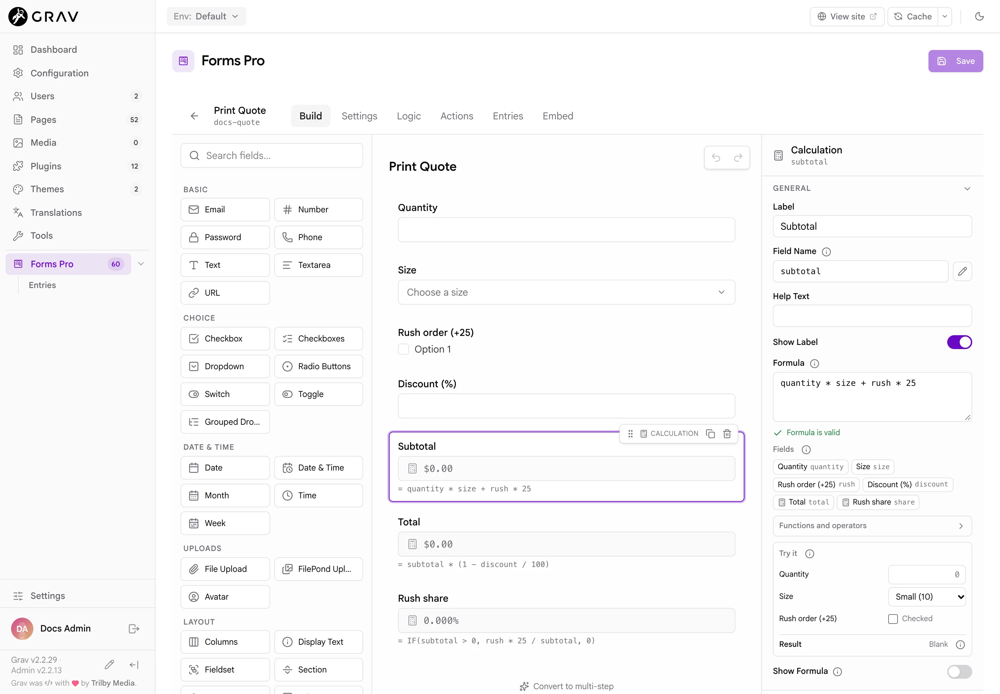

# Calculations

A **Calculation** field shows a value worked out from other fields in the same form, such as a total from a quantity and a price. The result updates as the visitor types. This page covers the field, calculator mode, the formula editor and calculations inside a Repeater. The formula language itself, with every function and operator, is on the [Formula reference](../formula-reference) page.

## Add a calculation

Under **Pro Fields**, click **Calculation**. Select it and write a formula in the **Formula** box, using the **Field Name** of the fields it reads:

```yaml
total:
  type: pro-calculation
  label: Total
  formula: 'quantity * price'
  prefix: '$'
```

A visitor cannot type into a calculation. It shows the result, and the form stores it. A formula names fields by their **Field Name** (see [The builder](../the-builder#the-property-panel)), written bare (`quantity`) or in braces (`{quantity}`).

### Options

| Key | Label | Default |
|---|---|---|
| `formula` | **Formula** | none. A blank formula is accepted as a draft and shows nothing. |
| `formula_display` | **Show Formula** | off. Shows the formula text under the result. |
| `format` | **Output Format** | `number`. Also `currency` and `percent`. |
| `decimals` | **Decimal Places** | `2`. The builder offers 0 to 6. |
| `prefix` | **Prefix** | none. Text before the value, such as `$`. |
| `suffix` | **Suffix** | none. Text after the value, such as ` USD`. |
| `grouping` | **Thousands Separator** | on. Shows `1,234.50` instead of `1234.50`. |
| `blank_until_filled` | **Blank Until Filled** | **Follow form mode**. See [Blank until filled](#blank-until-filled). |

The three **Output Format** choices differ only slightly. `number` and `currency` both show a number with the chosen decimals, and neither adds a currency symbol, so use **Prefix** for `$` or `€`. `percent` adds a `%` after the number but does not multiply by 100, so a formula that gives `0.25` shows `0.25%`. Write the formula to give the percentage you want to see (`ratio * 100`).

Numbers are written in the site's active language, so a German page shows `1.234,50` where an English one shows `1,234.50`.

## How results are rounded and stored

A calculation rounds its result to its **Decimal Places** (half away from zero, so `2.675` becomes `2.68`). The rounded number is what the visitor sees, what is stored in the entry, and what other calculations see when they read it.

A result the formula cannot produce, for example a division by zero or text where a number is needed, is blank: the visitor sees an empty field and the entry stores an empty value. A blank result counts as blank, not zero, to the calculations that read it.

### The server works it out again

The result the browser shows is a convenience. When the form is sent, the server throws away the posted value of every calculation and works it out again from the formulas stored in the form and the answers submitted. A visitor who edits the page to post `0.01` as a total gets the real total stored instead. This applies to calculations in a Repeater too. The browser and the server use the same rules, so they agree.

### Calculations reading calculations

A calculation can use another calculation, and they are worked out in dependency order, so the order on the canvas does not matter. Two calculations that read each other form a loop. The formula editor warns you, saving is refused, and if a loop does reach a live form, the calculations in it stay blank while the others still work.

## What a formula can read

A formula reads the answers of the form's fields. Each kind of field gives it a number:

| Field | Value in a formula |
|---|---|
| Number, Slider, Range, Rating | The number |
| Text and other single-line fields | The text, if it looks like a number (`12`, `-3.5`, `1e3`) |
| Dropdown, Radio Buttons | The selected option's **key**, if it is a number |
| Checkbox | `1` when ticked (or its value, if that is a number), `0` when not |
| Any empty field | `0` |
| A field hidden by [conditional logic](../conditional-logic) | `0` |
| Text that is not a number | No result |

To price options, give each option a number as its key and label it with words:

```yaml
size:
  type: select
  label: Size
  placeholder: Choose a size
  options:
    '10': 'Small (10)'
    '15': 'Large (15)'
```

A formula `quantity * size` then reads `10` or `15`. Write the keys in quotes, as above, so YAML keeps them as option keys.

> [!TIP]
> Browsers only accept whole numbers in a Number field until you give it a step. For prices and percentages, set `validate.step` to `0.01` or `any` on the Number fields a calculation reads.

## Blank until filled

By default, a calculation in a **calculator** shows a blank result until every field its formula uses has a value, instead of working from zeros. A calculation in an ordinary form works from zeros straight away. **Blank Until Filled** lets you choose for each calculation:

| Choice | Value | Result |
|---|---|---|
| **Follow form mode** | not set | Blank while inputs are empty in calculator mode, never blank in other forms |
| **Always** | `'1'` | Blank while any field the formula uses, directly or through other calculations, is empty |
| **Never** | `'0'` | Works from zeros as soon as the form loads |

An unticked checkbox counts as filled, since `0` is a real answer. A field hidden by logic does not hold a result back. This is a feature of what the visitor sees: the stored value of a submitted form is always the server's result.

## Calculator mode

Turn on **Calculator Mode** on the form's **Settings** tab, or write `mode: calculator` at the top of the YAML, and the form becomes a calculator:

- It shows no buttons, runs no actions and never submits. Pressing `Enter` in a field does nothing.
- Results update as the visitor types, and start blank until filled.
- The actions you set stay saved in the form, but do not run. The **Actions** tab says so and links to **Settings**, so you can turn the mode off again.

```yaml
title: Print Quote
type: forms-pro
mode: calculator
fields:
  quantity:
    type: number
    label: Quantity
  size:
    type: select
    label: Size
    placeholder: Choose a size
    options:
      '10': 'Small (10)'
      '15': 'Large (15)'
  rush:
    type: checkbox
    label: Rush order (+25)
  subtotal:
    type: pro-calculation
    label: Subtotal
    formula: 'quantity * size + rush * 25'
    prefix: '$'
```

With the quantity at 100, the size on Large and Rush ticked, the subtotal shows $1,525.00.

### Calculators and the page cache

A page with an ordinary form is excluded from Grav's page cache, because the form carries a per-visitor security token. A calculator has none: it is rendered without a token, form name or per-visitor value, never submitted, and every visitor gets the same HTML. A page that embeds only calculators therefore stays in the page cache, which keeps heavy-traffic calculator pages fast. This needs a Grav that records a page's scripts and styles when it caches the page. On one that does not, calculator pages are excluded from the cache like any form. A page that holds a calculator and an ordinary form is excluded as usual.

When you save a form in the builder, the pages that embed it are refreshed. After a hand edit to the YAML, run `bin/grav clear`.

## The formula editor

The **Formula** box in the property panel is more than a text box:



- **Fields** lists the form's input fields as chips. Click one to put its name in the formula at the cursor. With nine or more fields, a filter box appears.
- **Functions and operators** lists every function with a one-line description. Click one to add it at the cursor, and selected text goes inside its brackets.
- The editor checks the formula as you type against the form's real field names. It says what is wrong in plain words (`This form has no field named "pricee"`, `A closing bracket ")" is missing`) and marks the spot. It also warns about loops across calculations. While you are still typing, the red alert waits for a short pause, so a half-written formula does not flash errors.
- **Try it** works the formula out for sample values you type, with the field's own decimals, prefix and suffix, and says **No result** when the values give none (a division by zero, text where a number is needed) or **Blank** when **Blank Until Filled** would keep it blank for the visitor. Nothing in Try it is saved.

Saving checks every formula once more on the server. A formula that does not parse, names a field the form does not have, or forms a loop is refused with a message that names the field.

## Calculations in a Repeater

Put a Calculation inside a [Repeater](../field-reference#repeater) and it is worked out once per row, from that row's own fields. This is how you build an order form with a line total on each line:

```yaml
title: Order Form
type: forms-pro
fields:
  tax_rate:
    type: number
    label: Tax rate (%)
    default: 8
  lines:
    type: pro-repeater
    label: Items
    min: 1
    max: 10
    add_label: Add item
    item_label: Item
    fields:
      product:
        type: text
        label: Product
        validate:
          required: true
      quantity:
        type: number
        label: Quantity
        validate:
          min: 1
      price:
        type: number
        label: Price
        validate:
          step: 0.01
      line_total:
        type: pro-calculation
        label: Line total
        formula: 'quantity * price * (1 + tax_rate / 100)'
        prefix: '$'
buttons:
  - type: submit
    value: Order
process:
  - submission: true
  - message: Order received.
```

The rules for a row:

- A row's formula reads the other fields in the same row by name, and also any field outside the Repeater, such as `tax_rate` above. When a field in the row and a field outside share a name, the one in the row wins.
- A calculation outside the Repeater cannot read what is in the rows. A formula such as `SUM(line_total)` placed outside the list does not add up the rows: it works out to `0`. A grand total over the rows is not something calculations can do today.
- Rows added, removed and reordered by the visitor are worked out as they change. The server works out every row again when the form is sent, and stores the rows with their `line_total`.

With three of an item at 19.99 and an 8% tax rate, the row shows $64.77.

## Related

- [Formula reference](../formula-reference)
- [Settings tab](../settings-tab)
- [Field reference](../field-reference#repeater)
- [Embedding](../embedding)
