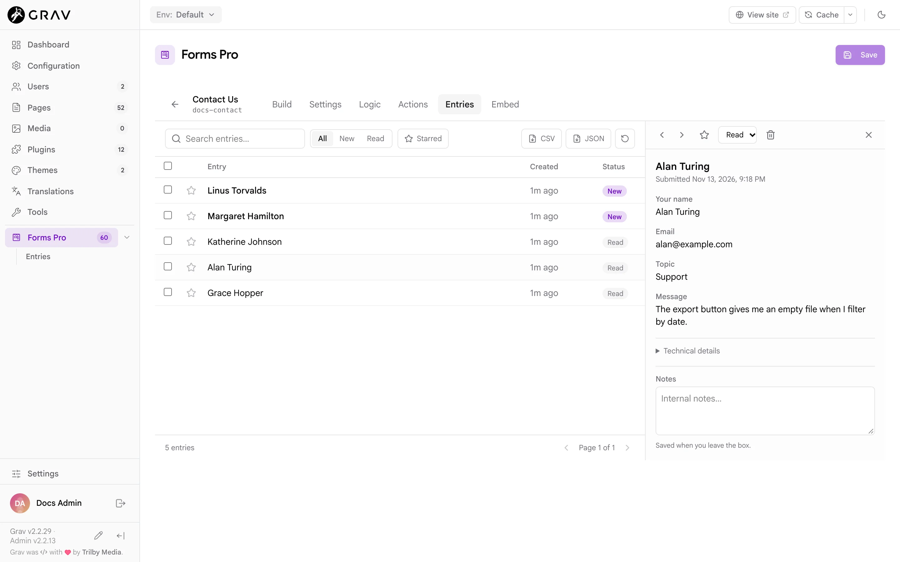

# Entries

An entry is one stored submission. Forms Pro keeps entries for every form that has a **Store Submission** action (see [Actions and notifications](../actions-and-notifications#data-actions)), and shows them in Admin Next, so you can read, sort and export what visitors sent without opening a file or an email.

## Where to find them

Entries appear in two places:

- The **Entries** item in the Forms Pro section of the sidebar opens an overview: one row for each form that has entries, with its total and a **new** count for the ones you have not opened. Click a row to open that form's entries.
- Inside a form, the **Entries** tab shows that form's list. From the forms list, the menu on a form also has **View entries**.

The **Forms Pro** sidebar item carries a badge with the number of unread entries across all forms.

A form with no entries yet shows **No entries yet**, and if the form has no **Store Submission** action the message says so.

## The entries list



The list shows 20 entries a page, newest first. Each row has the entry's title, which is built from its first answers (here, the visitor's name), how long ago it arrived, and its status. Entries from the last week show as `3h ago` or `2d ago`, older ones as a date.

- **Search** looks for the words you type in any answer, ignoring upper and lower case. It matches part of a word too.
- **All**, **New** and **Read** filter by status.
- **Starred** shows only entries you have starred.
- The star beside an entry marks it, which is useful for follow-ups.
- **CSV** and **JSON** download every entry of the form (see [Export](#export)).
- The circular arrow reloads the list. The list does not update on its own while you have it open.

Tick the boxes beside entries to select them. A bar appears with **Mark read**, **Mark unread**, **Star**, **Unstar** and **Delete**, and a **Clear** link to drop the selection. The box in the header selects every entry on the page.

An entry is **New** until someone opens it. Opening it marks it **Read**, and the badge counts down. You can set the status back to **New** from the entry panel or the selection bar if you want to come back to it.

## The entry panel

Click an entry to open it beside the list. It shows when it was sent, then every answer under its label in the form's order. Some answers are written out for reading:

- A name or address shows as one line of text (`Ada Lovelace`).
- A phone number with the country selector shows with the dial code, `+1 555 010 4477`.
- A choice shows its label, and several choices are listed together.
- A repeater shows one line for each row.
- A signature shows as an image.
- Rich text shows with its formatting, sanitized.
- Fields the visitor left empty are not listed in the table. A line at the end names them, as **Left blank: Phone, Company**.

The top of the panel has the arrows for the previous and next entry, a star, a status menu (**New** or **Read**), a bin to delete the entry, and a close button.

Under **Technical details** are the entry's ID and, if your settings record them, the visitor's IP address and browser. **Notes** is a box for your own comments, such as who followed up. It is saved when you click out of it, and the visitor never sees it.

Entries are changed by people with the Manage Submissions permission. Someone who can only read can still open entries and see all of this, except that opening an entry does not mark it read for them. See [Permissions](../permissions).

## Files

When a form has file fields and a **Process Uploads** action, each entry lists the files that came with it, under the field that received them, with the size of each. Click a file's name to download it. The download goes through Admin Next with your login, so only people who may read entries can fetch it, and the browser always downloads the file under its original name and never opens it in the page.

A file is shown as unavailable if it has since been moved or deleted from the folder it was saved to. An entry stored before uploads were recorded lists the file's name but cannot offer it for download.

The files themselves live where the field's **Upload Destination** says, which is `user-data://uploads` for a new field (see [Field reference](../field-reference#uploads)). Two things follow from that:

- Deleting an entry deletes the entry only. The uploaded files stay in the destination folder until you remove them yourself.
- Grav's stock server rules refuse YAML and JSON files under `user/data` when requested by address, but they do serve images, PDFs and other media from there. Anyone who knows or guesses a file's address can open it. Use **Randomize Filenames** (`random_name`) on the field so that names cannot be guessed, and do not collect files that must stay private unless your server blocks that folder. See [Installation](../installation#where-things-are-stored).

> [!NOTE]
> A form with file fields needs a **Process Uploads** action. It moves the files from where they wait to the field's destination. Without it the files are not kept, and the entry has nothing to download.

## Delete

The bin in the entry panel deletes one entry, and **Delete** in the selection bar deletes the selected ones. Both ask first, and neither can be undone. Deleting a form deletes all of its entries too, and the confirmation says how many.

## Export

**CSV** and **JSON** download all of a form's entries, newest first, whatever the search and filters on screen are set to.

The CSV has one row for each entry. The first columns are `id`, `created` (an ISO 8601 date such as `2026-11-14T03:42:52+00:00`), `status` and `starred`, followed by one column for each field in the entries, named by its Field Name. Answers with several parts or choices are joined with `; `, and booleans are `true` or `false`. Any cell that starts with `=`, `+`, `-` or `@` is prefixed with a single quote, so a spreadsheet does not run it as a formula.

The JSON is every entry as stored: the `data`, the `files`, and the `id`, `created`, `status`, `starred` and `notes` values, plus `ip` and `user_agent` when they were recorded.

## What is stored, and where

Each entry is one small YAML file in `user/data/forms-pro/submissions/<form name>/`, named from its date and ID, next to an `index.json` that the list reads. Here is one from a form with a name, an email address and an upload:

```yaml
data:
  name: Ada
  email: ada@example.com
files:
  -
    field: attachment
    name: red.png
    stored: red.png
    path: 'user-data://uploads/red.png'
    size: 355
    mime: image/png
ip: 203.0.113.7
user_agent: 'Mozilla/5.0 ...'
id: 7ffb6bccc673
form: contact-us
created: 1794627821
status: new
starred: false
notes: ''
```

The IP address and browser are recorded only if **Store IP Address** and **Store User Agent** are on in the plugin settings. Both are on by default. An IP address is personal data, so turn **Store IP Address** off if you do not need it and say what you keep in your privacy policy. See [Configuration](../configuration).

The answers an entry holds are the values after validation, and a Calculation field holds the value the server worked out, not what the browser posted. A hidden field's answer is stripped before the entry is stored (see [Conditional logic](../conditional-logic#what-hidden-means)). The honeypot field is never stored.

Entries are plain files, so they back up with the rest of `user/data`, and you can read them with any tool that reads YAML. Do not edit them by hand while visitors are submitting: the list reads from `index.json`, which Forms Pro keeps in step when it changes an entry.

If you want entries somewhere else too, use a **Webhook** (see [Webhooks](../webhooks)) or the [REST API](../rest-api).

## Related

- [Actions and notifications](../actions-and-notifications)
- [Permissions](../permissions)
- [REST API](../rest-api)
- [Configuration](../configuration)
